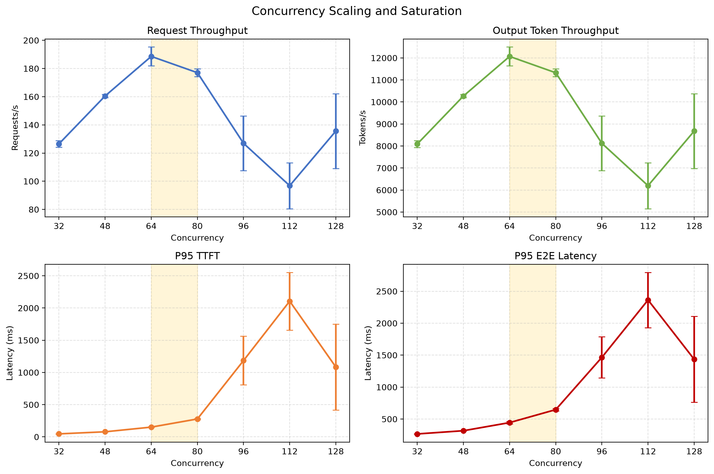
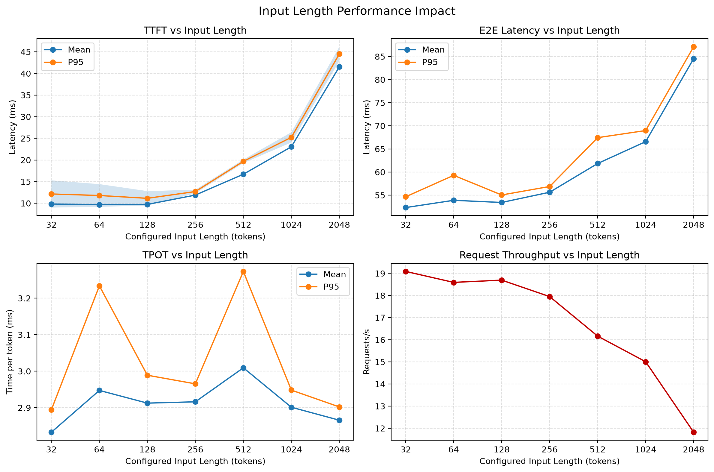
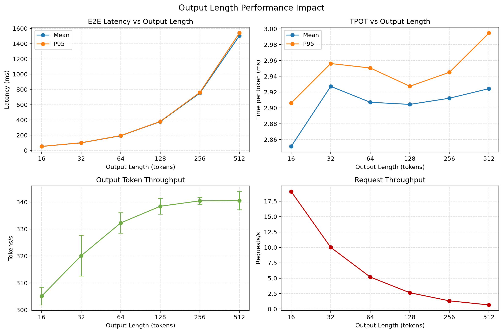
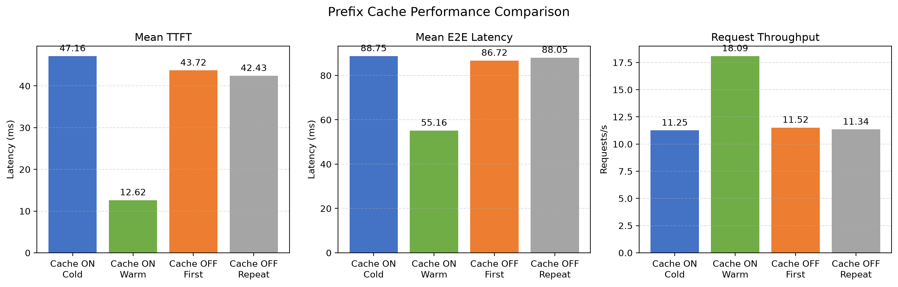

# llm-serve-bench

基于 vLLM 的大语言模型在线推理性能测试项目，分析并发数、输入长度、输出长度和 Prefix Cache 对吞吐量与延迟的影响。

## 测试环境

- GPU：NVIDIA GeForce RTX 4070 Ti 12GB
- 系统：WSL2 Ubuntu
- 模型：Qwen/Qwen2.5-0.5B-Instruct
- vLLM：0.27.1+cu129
- PyTorch：2.13.0+cu129
- CUDA：12.9
- 数据类型：BF16
- 最大模型长度：4096
- GPU 显存利用率：0.70
- 服务接口：OpenAI-compatible Chat Completions API
- 流式协议：SSE
- Python: 3.12.14
- NVIDIA Driver: 560.94

## 评价指标

- TTFT：从发送请求到收到首个 token 的时间，主要反映 Prefill 延迟。
- TPOT：除首 token 外，每生成一个 token 的平均时间，主要反映 Decode 性能。
- E2E：请求从发出到生成结束的端到端延迟。
- QPS：每秒完成的请求数。
- Output TPS：每秒生成的输出 token 数。

## 核心结果

### 单请求延迟

- TTFT Mean：9.426 ms
- TTFT P95：12.038 ms
- TPOT Mean：2.875 ms
- TPOT P95：2.884 ms
- E2E Mean：121.536 ms
- E2E P95：123.943 ms

### 并发扩展与饱和点

吞吐量在并发数 64 附近达到峰值，并发数达到 80 后开始下降。并发数超过 80 后，TTFT 和 E2E 延迟快速上升，表明服务进入过载状态。

### 输入长度影响

输入长度增加主要提高 Prefill 计算量。TTFT 在输入长度达到 512 tokens 后开始明显增长，而 TPOT 基本稳定。

### 输出长度影响

E2E 延迟随输出长度近似线性增长。TPOT 基本稳定在 2.85 至 3.00 ms/token，Output TPS 在长输出时稳定在约 340 tokens/s。

### Prefix Cache

相同长输入重复请求命中 Prefix Cache 后：

- TTFT Mean 从 47.16 ms 降至 12.62 ms，降低约 73.2%。
- TTFT P95 从 58.68 ms 降至 13.88 ms，降低约 76.3%。
- E2E Mean 从 88.75 ms 降至 55.16 ms，降低约 37.8%。
- QPS 从 11.25 提高至 18.09，提高约 60.8%。

关闭 Prefix Cache 后，第一次和重复运行的性能基本一致，证明加速来自 Prefix Cache。

## 项目文档

- `EXPERIMENTS.md`：实验配置、过程、结果和局限性。
- `TROUBLESHOOTING.md`：实验过程中遇到的问题、定位过程和解决方案。
- `figures/`：实验结果图。
- `*_summary.csv`：各项实验的最终汇总数据。
- `*_runs.csv`：多轮实验的单轮统计数据。
- `*_results/`：vLLM Benchmark 生成的原始 JSON 数据。

## 当前结论

该测试环境的推荐并发范围为 48 至 64。输入长度主要影响 Prefill 和 TTFT，输出长度主要影响 Decode 总耗时和 E2E。Prefix Cache 对重复长前缀请求具有显著优化效果，但不会直接改善 Decode 阶段的单 token 生成速度。
